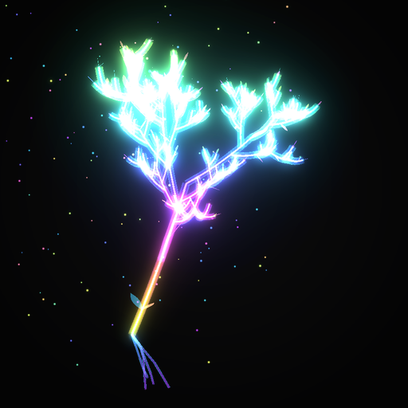
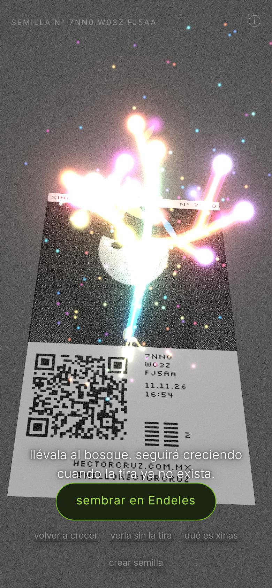
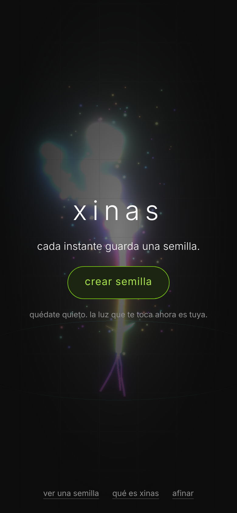
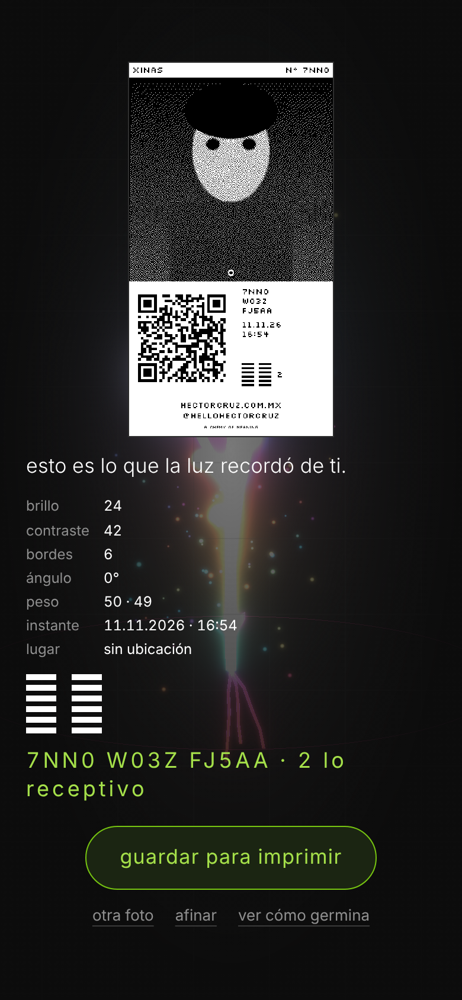
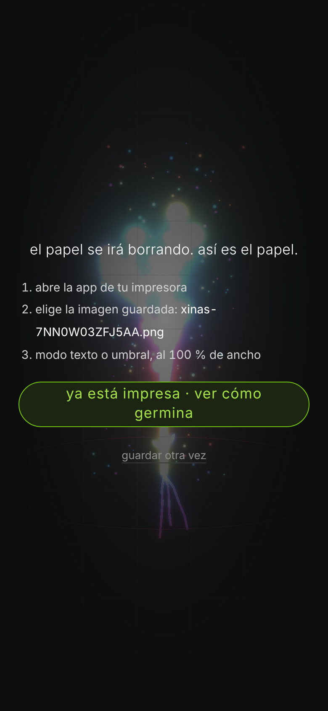
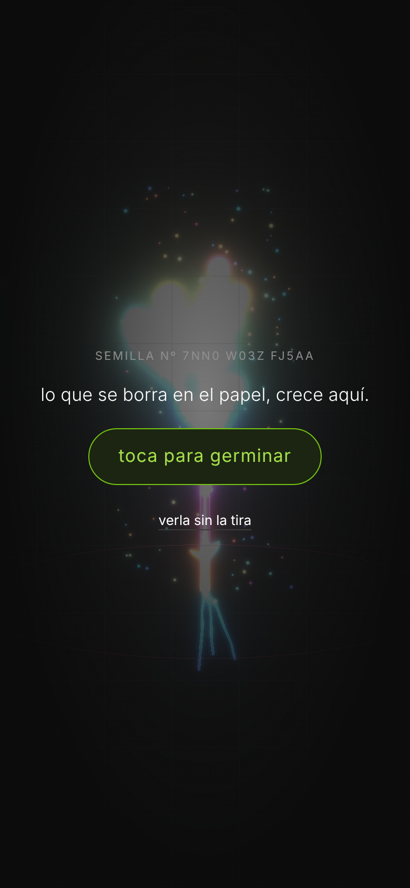
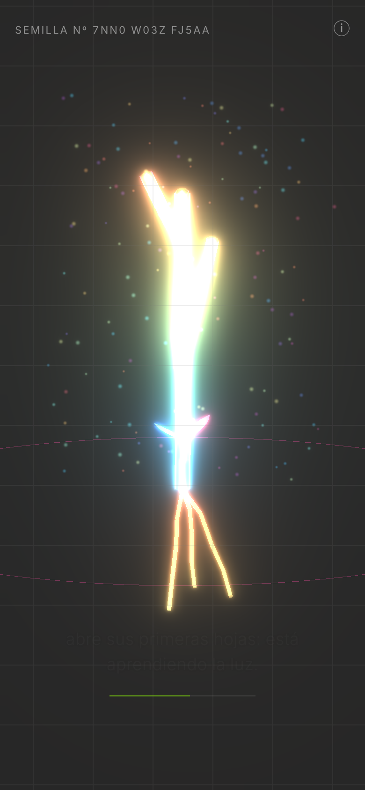
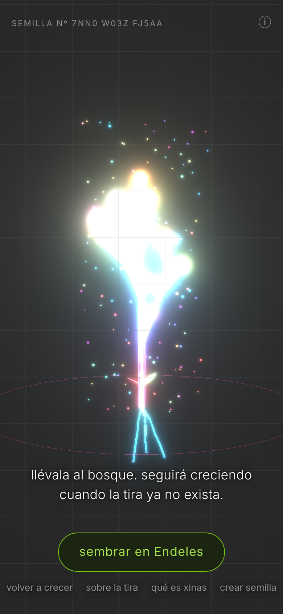
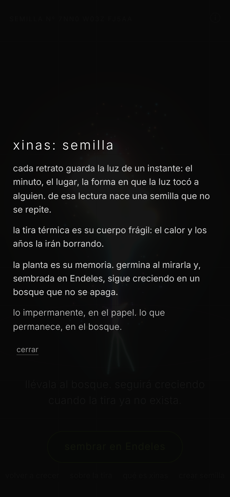
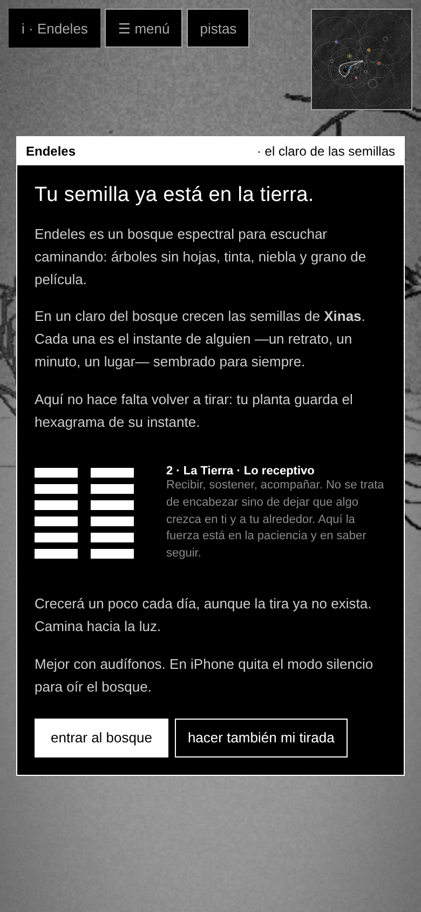

# Xinas

**v0.8** · Colección Alchemy of Meaning · GPL-3.0

## Español

*xinas: semilla.* Cada retrato guarda la luz de un instante: el minuto, el lugar, la forma en que la luz tocó a alguien. De esa lectura nace una semilla que no se repite. La tira térmica es su cuerpo frágil: el calor y los años la irán borrando. La planta es su memoria: germina al mirarla y, sembrada en Endeles, sigue creciendo en un bosque que no se apaga.

*Lo impermanente, en el papel. Lo que permanece, en el bosque.*

### Las capas

1. **Umbral.** Al abrir Xinas sin código: el nombre, un verso y un botón grande, **crear semilla**.
2. **Crear.** Se abre la cámara del teléfono. Del retrato salen seis lecturas (brillo, contraste, bordes, ángulo y el peso visual en x e y). Del instante salen el minuto y el lugar, aproximado a ~1 km y solo con permiso. Todo eso forma un código de 13 caracteres sin nada al azar.
3. **Lectura del instante.** La tira aparece, los números de la luz se juntan, el hexagrama se forma línea por línea y se escribe el código. Desde aquí se puede **afinar**: encuadre, contraste, tramado, fusión con otra foto, lugar y pie.
4. **Imprime.** Guardar manda la tira de 58 × 88 mm a Fotos para imprimirla desde la app de la impresora térmica.
5. **Germina.** Es lo que abre el QR de la tira. Con un toque, la cámara se vuelve blanco y negro, y sobre la tira se juntan puntos de luz y nace la planta: raíz, tallo, ramas, hojas y flor, en unos 25 segundos y con un verso para cada etapa. La planta es luz iridiscente, con la paleta propia de cada semilla. También se puede ver sin la tira, sobre negro. La germinación suena: la música sale de la misma semilla (tónica, escala según el hexagrama y pulso), con un pedal que se abre conforme crece, una nota pulsada por cada rama que nace, campanas para las hojas y un acorde cuando florece. Una semilla siempre suena igual.
6. **Mis semillas.** El teléfono recuerda las semillas que germinaste: desde el umbral o al final de la germinación puedes volver a germinarlas o ir a verlas a Endeles.
7. **Sembrar en Endeles.** Al bosque solo viajan el número de la semilla y su minuto. Endeles la recibe en el claro de las semillas, donde sigue creciendo cada día. El hexagrama es el mismo en la tira, en Xinas y en el bosque: no se vuelve a tirar.

### Herbario de lecturas

Cada etapa de la germinación trae, además de su verso, una lectura breve parafraseada de un autor que piensa la semilla, el instante o el azar: Emanuele Coccia (*La vida de las plantas*), Dōgen (*Uji*, ser-tiempo), Goethe (*La metamorfosis de las plantas*), Borges (*El jardín de senderos que se bifurcan*), Roland Barthes (*La cámara lúcida*: el minuto de tu retrato es único) y C. G. Jung (prólogo al *I Ching* de Wilhelm: el hexagrama retrata el instante). El herbario completo está en «qué es xinas».

La interfaz toma el color de cada semilla: el acento de botones, código y pulso es el de su planta, igual en Xinas que en Endeles.

### Instalar

- Se guarda en la pantalla de inicio del teléfono como app: en Safari, Compartir › «Agregar a inicio». Abre a pantalla completa, con su ícono, su carátula de arranque y sin conexión una vez abierta.
- `index.html` es la app completa en un solo archivo. Junto a él van `manifest.webmanifest`, `sw.js` y la carpeta `iconos/`. Súbela a `https://hectorcruz.com.mx/app/xinas/`.
- Endeles va junto: `…/app/endeles/`, con su `semillas.php`. Xinas encuentra la carpeta `endeles` o `Endeles`.
- Tiene que servirse por **HTTPS**: sin HTTPS el navegador no da la cámara ni la ubicación.
- El QR de cada tira apunta a `…/app/xinas/?s=CÓDIGO&t=MINUTO`.
- Para imprimir, usa la app de la impresora térmica en modo texto o umbral, al 100 % de ancho.

### Privacidad

El retrato nunca sale del teléfono. Al QR y a Endeles solo viajan el código y el minuto. El código incluye, mezclada, la ubicación redondeada si se dio permiso.

### Código fuente

- `src/planta.js` es el núcleo compartido: código ↔ planta, hexagrama, paleta, instante, edad y tira. Endeles usa una copia.
- `src/musica.js` es la música de la germinación (Web Audio, sin archivos).
- `src/visor.js` contiene las capas, la germinación, el fondo de cámara en blanco y negro, el bloom, jsQR y la pose.
- `src/app.js` es el editor de la tira (afinar).
- `src/xinas.html` es la plantilla.

Para armar el archivo: `npm install && python3 build.py` (genera `index.html`).

## English

*xinas: seed.* Every portrait holds the light of a moment: the minute, the place, the way light touched someone. That reading becomes a seed that never repeats. The thermal strip is its fragile body; heat and years will erase it. The plant is its memory: it sprouts when you look at it and, planted in Endeles, keeps growing in a forest that never goes dark.

### Layers

1. **Threshold:** the name, a line and one large button, *crear semilla* (create seed).
2. **Create:** the phone camera opens. The portrait gives six readings and the moment gives the minute and an approximate place. Together they form a 13-character code with nothing random in it.
3. **Reading of the moment:** the strip appears, the numbers gather, the hexagram builds line by line. You can fine-tune the strip from here.
4. **Print:** save the 58 × 88 mm strip to Photos and print it from the thermal printer's app.
5. **Sprout:** this is what the strip's QR opens. One tap and the camera turns black and white; light gathers on the strip and the plant is born, from root to flower, in about 25 seconds, with a line of verse for each stage. It can also be seen without the strip, on black. The sprouting has its own procedural music, born from the same seed: a drone that opens as it grows, a plucked note for each new branch, bells for leaves, a chord when it blooms.
6. **Plant it in Endeles:** only the seed number and its minute travel. The plant joins the clearing of seeds and keeps growing day by day, with the same hexagram as on the strip.

### Herbarium of readings

Each stage of sprouting brings, besides its verse, a short paraphrased reading from an author who thinks about seeds, moments or chance: Coccia, Dōgen, Goethe, Borges, Barthes and Jung (foreword to Wilhelm's *I Ching*). The interface takes each seed's color as its accent, in Xinas and in Endeles alike.

### Install

Add it to the home screen from Safari (Share › Add to Home Screen): it opens full screen, with its icon and launch screen, and works offline. Upload `index.html`, `manifest.webmanifest`, `sw.js` and `iconos/` to `https://hectorcruz.com.mx/app/xinas/`, with Endeles and its `semillas.php` in `…/app/endeles/`. Serve both over HTTPS. Build from source with `npm install && python3 build.py`.

## Capturas / Screenshots

| | | |
|:-:|:-:|:-:|
|  umbral / threshold |  lectura del instante / reading |  imprime / print |
|  toca para germinar / tap to sprout |  crece / growing |  sobre la tira / on the strip |
|  sembrar en Endeles / plant it |  qué es xinas / what it is |  llegada a Endeles / arrival |

## Licencia / License

GPL-3.0. Incluye / includes three.js (MIT), jsQR (Apache-2.0), QR Code Generator de Kazuhiko Arase (MIT) y la fuente Silkscreen (OFL).

## Créditos / Credits

Diseño, investigación y desarrollo: Héctor Cruz Juárez — https://hectorcruz.com.mx  
Colección Alchemy of Meaning.
