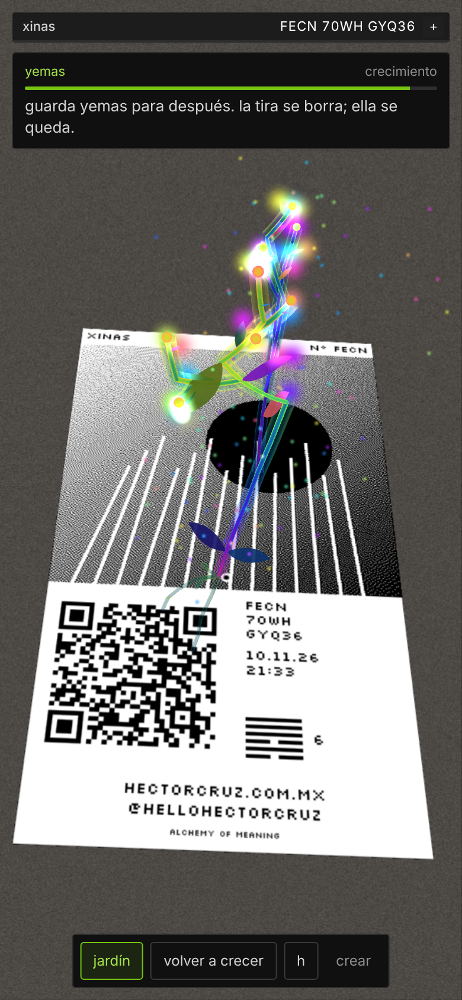
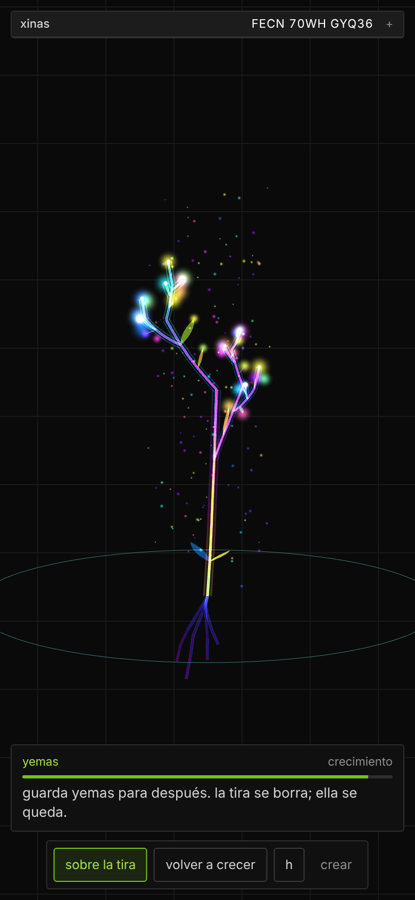
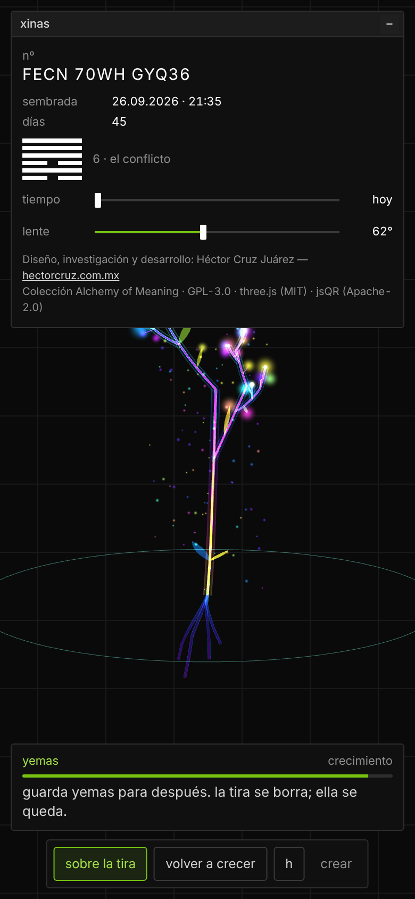
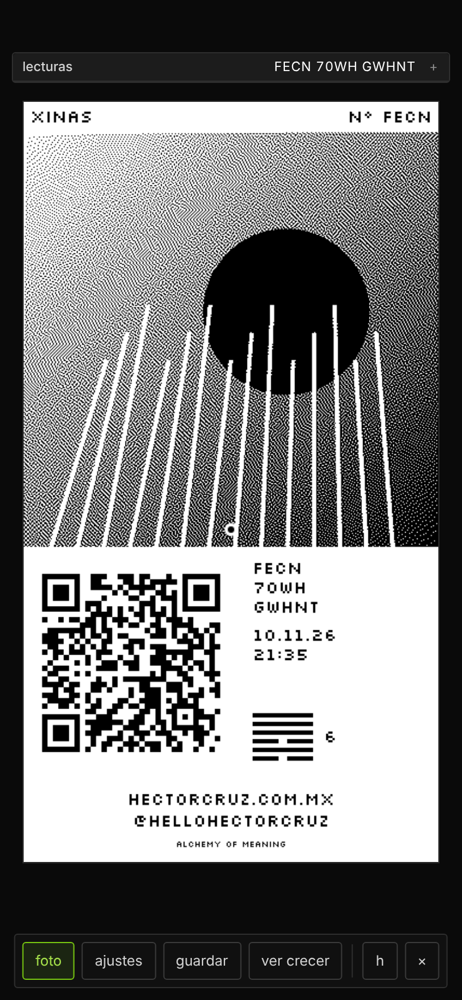
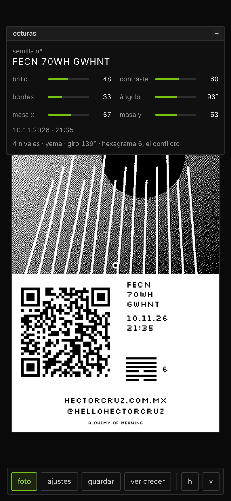
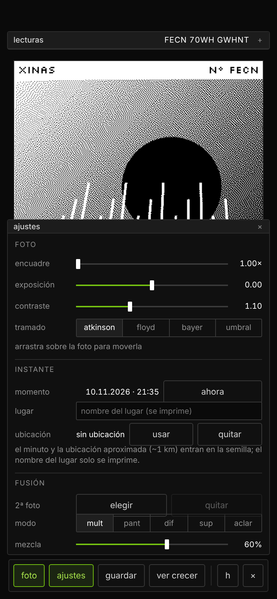
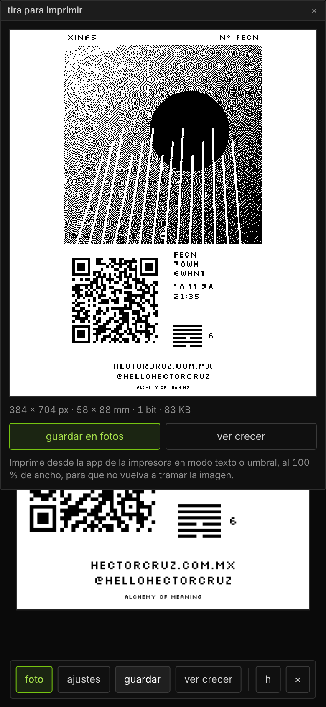
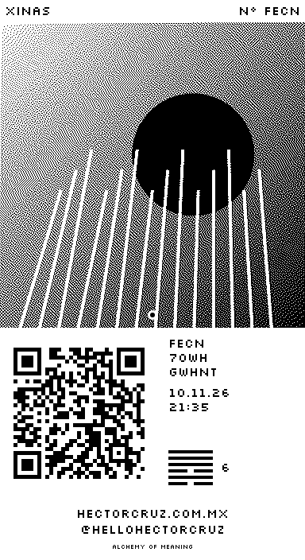
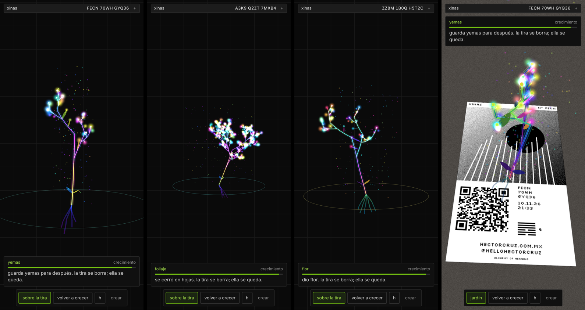

# Xinas



**v0.4** · Colección Alchemy of Meaning · GPL-3.0

## Español

Xinas convierte un retrato y su instante en una semilla. De la foto salen seis lecturas: brillo, contraste, bordes, ángulo dominante y el peso visual en x y en y. Del instante salen el minuto exacto y el lugar, redondeado a ~1 km. Todo eso forma un código de 13 caracteres, sin nada al azar, y ese código es la planta entera: su forma, su manera de ramificar, sus hojas o flores, su paleta de luz y su hexagrama del I Ching. La misma persona en otro momento u otro lugar da otra planta.

La semilla se imprime en una tira térmica de 58 × 88 mm con el retrato tramado, un QR, el nº, la fecha y hora, el lugar y el hexagrama. Al escanear el QR se abre el visor con la planta de ese instante: luminosa, iridiscente, con polen y destellos. Crece con los días que pasan desde el retrato. Con la cámara, brota en AR desde el pie del retrato, sobre el mismo papel. La tira se borra con el tiempo; la planta madura.

El hexagrama viaja dentro de la semilla: es el mismo en la tira, en el visor y, más adelante, en el bosque de Endeles.

### Qué hace

- **Visor (lo que se abre primero)**
  - **jardín:** la planta en 3D sobre negro, hecha de luz; arrastra para rodearla.
  - **sobre la tira:** usa la cámara, toma el QR como marcador y hace brotar la planta desde el punto impreso al pie del retrato. Si apuntas a otra tira, cambia a esa semilla.
  - **tiempo:** adelanta días para ver cómo será.
  - **lente:** calibra el ángulo de la cámara (62° por defecto).
  - **etapas:** semilla, raíz, brote, tallo, ramas, hojas y flor (o follaje, o yemas), cada una con una frase.
- **crear (botón discreto en la barra)**
  - Retrato, con fusión opcional de una segunda foto.
  - **Instante:** el minuto de la foto (o «ahora»), la ubicación aproximada (con permiso) y el nombre del lugar, que se imprime.
  - Encuadre, exposición, contraste y tramado (Atkinson, Floyd–Steinberg, Bayer o umbral).
  - Tira de 384 × 704 px (58 × 88 mm a 203 dpi), en 1 bit, con pie de dos líneas.
  - **guardar** la manda a Fotos para imprimir desde la app de la impresora. **ver crecer** vuelve al visor con esa semilla.

### Instalar

Es un solo archivo: `index.html`. Súbelo a cualquier hosting con **HTTPS** (sin HTTPS el navegador no da la cámara ni la ubicación). La ruta prevista es `https://hectorcruz.com.mx/app/xinas/`, y el QR de cada tira apunta ahí: `…/app/xinas/?s=CÓDIGO&t=MINUTO`. La dirección del QR se cambia en crear › ajustes › «QR lleva a».

Para imprimir, usa la app de la impresora térmica en modo texto o umbral, al 100 % de ancho, para que no vuelva a tramar la imagen.

### Privacidad

El retrato nunca sale del teléfono. Al QR, y más adelante a Endeles, solo viajan el código, el minuto y, si se usó, la ubicación redondeada a ~1 km.

### Código fuente

- `src/planta.js` es el núcleo compartido: código ↔ planta 3D determinista, hexagrama, paleta, instante, edad y medidas de la tira. Es el mismo que usará Endeles.
- `src/app.js` es el editor de la tira.
- `src/visor.js` es el visor: Three.js, shaders iridiscentes, jsQR, homografía y pose.
- `src/xinas.html` es la plantilla.

Para armar el archivo:

```
npm install
python3 build.py     # genera index.html
```

## English

Xinas turns a portrait and its moment into a seed. The photo yields six readings: brightness, contrast, edges, dominant angle and visual weight in x and y. The moment adds the exact minute and the place, rounded to ~1 km. Together they form a 13-character code, with nothing random in it, and that code is the whole plant: its shape, its branching, its leaves or flowers, its palette of light and its I Ching hexagram. The same person at another moment or in another place grows another plant.

The seed is printed on a 58 × 88 mm thermal strip with the dithered portrait, a QR code, the number, date and time, the place and the hexagram. Scanning the QR opens the viewer with the plant of that moment: luminous, iridescent, with pollen and sparks. It grows with the days since the portrait. With the camera, it sprouts in AR from the foot of the portrait, on the same paper. The strip fades over time; the plant matures.

The hexagram travels inside the seed: it is the same on the strip, in the viewer and, later on, in the Endeles forest.

### Features

- **Viewer (opens first)**
  - **garden:** the 3D plant made of light on black; drag to orbit it.
  - **on the strip:** uses the camera, tracks the QR as a marker and grows the plant from the printed point at the foot of the portrait. Point at another strip and it switches to that seed.
  - **time:** jump ahead in days to see what it will become.
  - **lens:** calibrates the camera angle (62° by default).
  - **stages:** seed, root, sprout, stem, branches, leaves and flower (or foliage, or buds), each with a short line.
- **create (quiet button in the bar)**
  - Portrait, with optional blending of a second photo.
  - **Moment:** the photo's minute (or "now"), the approximate location (with permission) and the place name, which is printed.
  - Framing, exposure, contrast and dithering (Atkinson, Floyd–Steinberg, Bayer or threshold).
  - Strip of 384 × 704 px (58 × 88 mm at 203 dpi), 1-bit, with a two-line footer.
  - **save** sends it to Photos to print from the printer's app. **watch it grow** returns to the viewer with that seed.

### Install

It is a single file: `index.html`. Upload it to any host with **HTTPS** (browsers only allow the camera and location over HTTPS). The intended path is `https://hectorcruz.com.mx/app/xinas/`, and each strip's QR points there: `…/app/xinas/?s=CODE&t=MINUTE`. The QR address is changed in create › settings › «QR lleva a».

To print, use the thermal printer's app in text or threshold mode, at 100 % width, so it does not dither the image again.

### Privacy

The portrait never leaves the phone. Only the code, the minute and, if used, the location rounded to ~1 km travel in the QR (and, later on, to Endeles).

### Source

- `src/planta.js` is the shared core: code ↔ deterministic 3D plant, hexagram, palette, moment, age and strip measurements. Endeles will use the same file.
- `src/app.js` is the strip editor.
- `src/visor.js` is the viewer: Three.js, iridescent shaders, jsQR, homography and pose.
- `src/xinas.html` is the template.

To build the file:

```
npm install
python3 build.py     # writes index.html
```

## Capturas / Screenshots

| | | |
|:-:|:-:|:-:|
| <br>jardín / garden | <br>semilla y hexagrama / seed and hexagram | <br>sobre la tira (AR) / on the strip (AR) |
| <br>crear la tira / create the strip | <br>lecturas e instante / readings and moment | <br>ajustes e instante / settings and moment |
| <br>guardar para imprimir / save to print | <br>tira de 58 × 88 mm / 58 × 88 mm strip | <br>tres semillas y AR / three seeds and AR |

## Licencia / License

GPL-3.0. Incluye / includes three.js (MIT), jsQR (Apache-2.0), QR Code Generator de Kazuhiko Arase (MIT) y la fuente Silkscreen (OFL).

## Créditos / Credits

Diseño, investigación y desarrollo: Héctor Cruz Juárez — https://hectorcruz.com.mx  
Colección Alchemy of Meaning.
