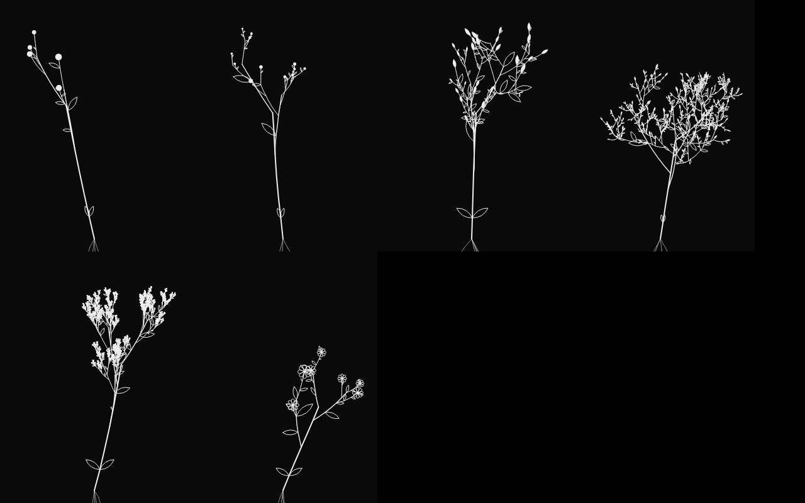

# Xinas


**v0.3** · Colección Alchemy of Meaning · GPL-3.0

## Español

Xinas convierte una fotografía en una semilla. De la foto salen seis lecturas (brillo, contraste, bordes, ángulo dominante y el peso visual en x y en y). Con ellas se arma un código de 13 caracteres, y ese código es la planta entera: su forma, su manera de ramificar, sus hojas o flores y su hexagrama del I Ching.

La semilla se imprime en una tira térmica de 58 mm con la foto tramada, un QR, el hexagrama y el brote recién nacido. Al escanear el QR se abre el visor. La planta crece según los días que han pasado desde la impresión, y con la cámara brota en AR desde el brote impreso, sobre el mismo papel. La tira se borra con el tiempo; la planta madura.

### Qué hace

- **Visor (lo que se abre primero)**
  - **jardín:** la planta en 3D, girando; arrastra para rodearla.
  - **sobre la tira:** usa la cámara, toma el QR como marcador y hace brotar la planta desde la raíz impresa. Si apuntas a otra tira, cambia a esa semilla.
  - **tiempo:** adelanta días para ver cómo será.
  - **trazo:** tinta (negro) o luz (blanco).
  - **lente:** calibra el ángulo de la cámara (62° por defecto).
  - **etapas:** semilla, raíz, brote, tallo, ramas, hojas y flor (o follaje, o yemas), cada una con una frase.
- **crear (botón discreto en la barra)**
  - Foto, con fusión opcional de una segunda foto (multiplicar, pantalla, diferencia, superponer, aclarar).
  - Encuadre, exposición, contraste y tramado (Atkinson, Floyd–Steinberg, Bayer o umbral).
  - Tira de 384 px de ancho a 203 dpi, de 112 a 150 mm de largo, en 1 bit, con pie de dos líneas.
  - **guardar** la manda a Fotos para imprimir desde la app de la impresora. **ver crecer** vuelve al visor con esa semilla.

### Instalar

Es un solo archivo: `index.html`. Súbelo a cualquier hosting con **HTTPS** (sin HTTPS el navegador no da la cámara). La ruta prevista es `https://hectorcruz.com.mx/app/xinas/`, y el QR de cada tira apunta ahí: `…/app/xinas/?s=CÓDIGO&t=DÍA`. La dirección del QR se cambia en crear › ajustes › «QR lleva a».

Para imprimir, usa la app de la impresora térmica en modo texto o umbral, al 100 % de ancho, para que no vuelva a tramar la imagen.

### Código fuente

- `src/planta.js` es el núcleo compartido: código ↔ planta 3D determinista, hexagrama, edad por días y medidas de la tira. Es el mismo que usará Endeles para sembrar estas plantas en el bosque.
- `src/app.js` es el editor de la tira.
- `src/visor.js` es el visor: Three.js, jsQR, homografía y pose.
- `src/xinas.html` es la plantilla.

Para armar el archivo:

```
npm install
python3 build.py     # genera index.html
```

## English

Xinas turns a photograph into a seed. The photo yields six readings (brightness, contrast, edges, dominant angle and visual weight in x and y). They form a 13-character code, and that code is the whole plant: its shape, its branching, its leaves or flowers and its I Ching hexagram.

The seed is printed on a 58 mm thermal strip with the dithered photo, a QR code, the hexagram and the newborn sprout. Scanning the QR opens the viewer. The plant grows with the days since printing, and with the camera it sprouts in AR from the printed sprout, on the same paper. The strip fades over time; the plant matures.

### Features

- **Viewer (opens first)**
  - **garden:** the 3D plant, turning; drag to orbit it.
  - **on the strip:** uses the camera, tracks the QR as a marker and grows the plant from the printed root. Point at another strip and it switches to that seed.
  - **time:** jump ahead in days to see what it will become.
  - **stroke:** ink (black) or light (white).
  - **lens:** calibrates the camera angle (62° by default).
  - **stages:** seed, root, sprout, stem, branches, leaves and flower (or foliage, or buds), each with a short line.
- **create (quiet button in the bar)**
  - Photo, with optional blending of a second photo (multiply, screen, difference, overlay, lighten).
  - Framing, exposure, contrast and dithering (Atkinson, Floyd–Steinberg, Bayer or threshold).
  - Strip 384 px wide at 203 dpi, 112 to 150 mm long, 1-bit, with a two-line footer.
  - **save** sends it to Photos to print from the printer's app. **watch it grow** returns to the viewer with that seed.

### Install

It is a single file: `index.html`. Upload it to any host with **HTTPS** (browsers only allow the camera over HTTPS). The intended path is `https://hectorcruz.com.mx/app/xinas/`, and each strip's QR points there: `…/app/xinas/?s=CODE&t=DAY`. The QR address is changed in create › settings › «QR lleva a».

To print, use the thermal printer's app in text or threshold mode, at 100 % width, so it does not dither the image again.

### Source

- `src/planta.js` is the shared core: code ↔ deterministic 3D plant, hexagram, age by days and strip measurements. Endeles will use the same file to plant these seeds in its forest.
- `src/app.js` is the strip editor.
- `src/visor.js` is the viewer: Three.js, jsQR, homography and pose.
- `src/xinas.html` is the template.

To build the file:

```
npm install
python3 build.py     # writes index.html
```

## Capturas / Screenshots

| | | |
|:-:|:-:|:-:|
| <br>jardín / garden | <br>semilla y hexagrama / seed and hexagram | <br>sobre la tira (AR) / on the strip (AR) |
| <br>crear la tira / create the strip | <br>lecturas de la foto / photo readings | <br>ajustes / settings |
| <br>guardar para imprimir / save to print | <br>tira de 58 × 118 mm / 58 × 118 mm strip | <br>seis semillas distintas / six different seeds |

## Licencia / License

GPL-3.0. Incluye / includes three.js (MIT), jsQR (Apache-2.0), QR Code Generator de Kazuhiko Arase (MIT) y la fuente Silkscreen (OFL).

## Créditos / Credits

Diseño, investigación y desarrollo: Héctor Cruz Juárez — https://hectorcruz.com.mx  
Colección Alchemy of Meaning.
